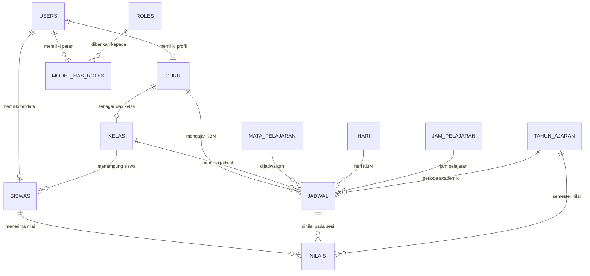

# 📑 LAPORAN TUGAS UJIAN TENGAH SEMESTER (UTS)
## MATA KULIAH: BASIS DATA LANJUT (SEMESTER 5)

---

### IDENTITAS MAHASISWA & PROYEK
- **Topik Proyek:** Perancangan & Implementasi Sistem Informasi Akademik (SIAKAD) Terpadu Berbasis Cloud & Multi-Peran (RBAC)
- **Studi Kasus:** SMP Negeri 1 Trimurjo, Kabupaten Lampung Tengah
- **Repositori GitHub:** [https://github.com/auliasalsabila169-tech/SIAKAD-SMPN-1-TRIMURJO](https://github.com/auliasalsabila169-tech/SIAKAD-SMPN-1-TRIMURJO)
- **Tautan Live Web:** [https://auliasalsabila.vercel.app](https://auliasalsabila.vercel.app)
- **Tautan Dokumentasi & Bagan Matriks:** [https://auliasalsabila.vercel.app/alur](https://auliasalsabila.vercel.app/alur)

---

## BAB I: PENDAHULUAN

### 1.1 Latar Belakang
Pengelolaan data akademik di instansi pendidikan tingkat pertama sering menghadapi kendala fragmentasi data, inkonsistensi pencatatan nilai antar guru mata pelajaran, serta keterlambatan kompilasi buku leger oleh wali kelas. Pada era Kurikulum Merdeka, penilaian tidak hanya mencakup nilai sumatif, melainkan juga pemetaan asesmen formatif, capaian kompetensi, dan pelaporan yang transparan kepada peserta didik.

Oleh karena itu, proyek ini mengimplementasikan **SIAKAD SMP Negeri 1 Trimurjo** dengan pendekatan basis data relasional tingkat lanjut, memanfaatkan arsitektur penyimpanan komputasi awan (*TiDB Serverless Cloud Database* berbasis MySQL protocol dengan enkripsi TLS/SSL) dan arsitektur kontrol akses berbasis peran (*Role-Based Access Control / RBAC*).

### 1.2 Tujuan Proyek
1. Merancang basis data relasional yang memenuhi kaidah normalisasi (1NF, 2NF, 3NF) untuk menangani data induk siswa, guru, rombel kelas, jadwal KBM, dan penilaian.
2. Memetakan wewenang dan hak akses masing-masing pengguna (Tata Usaha, Guru Mapel, Wali Kelas, Siswa) melalui matriks operasi CRUD.
3. Menyusun penjadwalan KBM mingguan bebas bentrok (*zero-conflict schedule*) selama hari Senin hingga Jumat.
4. Mengimplementasikan data pengujian skala penuh (minimal 20 siswa per kelas untuk 6 kelas, 10 guru pengajar, dan 100% keterisian nilai).

---

## BAB II: ANALISIS KEBUTUHAN ENTITAS & ROLE-BASED ACCESS CONTROL (RBAC)

### 2.1 Entitas Pengguna (Actors / Roles)
Sistem memiliki 4 entitas pengguna dengan batasan wewenang yang tegas:

1. **Tata Usaha (Admin / TU):**
   - Bertanggung jawab atas integritas master data (Siswa, Guru, Kelas, Mata Pelajaran).
   - Memiliki hak eksklusif dalam pembuatan (*Create*) dan pengubahan (*Update*) jadwal KBM seluruh sekolah.
   - Bertindak sebagai validator final yang memberikan status pengesahan (*ACC Nilai*) pada seluruh rombel kelas.
2. **Guru Mata Pelajaran:**
   - Memiliki hak baca (*Read*) terhadap jadwal mengajar pribadinya.
   - Memiliki hak input dan sunting (*Create, Read, Update*) nilai asesmen siswa khusus pada mata pelajaran dan kelas yang diampunya.
3. **Wali Kelas:**
   - Guru yang ditugaskan membina satu rombel kelas tertentu.
   - Memiliki hak baca (*Read*) atas jadwal KBM kelas binaannya.
   - Merekapitulasi nilai dari semua guru mata pelajaran dan mencetak **Buku Leger Nilai** resmi.
4. **Siswa:**
   - Memiliki hak baca (*Read*) atas biodata pribadi, jadwal KBM kelasnya, dan hasil belajar/transkrip rapor mandiri.

---

### 2.2 Bagan Matriks Relasi Entitas & Operasi CRUD

Keterangan:
- **C** = *Create* (Menambah data baru)
- **R** = *Read* (Membaca / menampilkan data)
- **U** = *Update* (Menyunting / memperbarui data)
- **D** = *Delete* (Menghapus data)

| Tabel / Entitas Basis Data | 🏛️ Tata Usaha (TU) | 👨‍🏫 Guru Mapel | 📋 Wali Kelas | 🎓 Siswa |
| :--- | :---: | :---: | :---: | :---: |
| **`users`** *(Akun & Otentikasi)* | **C, R, U, D** | **R, U** *(Akun Sendiri)* | **R, U** *(Akun Sendiri)* | **R, U** *(Akun Sendiri)* |
| **`guru`** *(Biodata Tenaga Pendidik)* | **C, R, U, D** | **R** *(Profil)* | **R** *(Profil)* | **R** *(Nama Pengajar)* |
| **`siswas`** *(Buku Induk Siswa)* | **C, R, U, D** | **R** *(Siswa Diajar)* | **R** *(Siswa Binaan)* | **R** *(Biodata Sendiri)* |
| **`kelas`** *(Rombongan Belajar)* | **C, R, U, D** | **R** *(Kelas Ajar)* | **R** *(Kelas Binaan)* | **R** *(Kelas Sendiri)* |
| **`mata_pelajaran`** *(Kurikulum)* | **C, R, U, D** | **R** | **R** | **R** |
| **`jadwal`** *(Plotting Sesi KBM)* | **C, R, U, D** *(Hak Tunggal)* | **R** *(Jadwal Mengajar)* | **R** *(Jadwal Binaan)* | **R** *(Jadwal Belajar)* |
| **`nilais`** *(Tugas, UTS, UAS, NA)* | **R, U** *(Otoritas ACC)* | **C, R, U** *(Mapel Diampu)* | **R** *(Rekap Leger)* | **R** *(Rapor Pribadi)* |

---

## BAB III: PERANCANGAN BASIS DATA RELASIONAL

### 3.1 Entity Relationship Diagram (ERD)

### 3.2 Analisis Normalisasi Basis Data
1. **Bentuk Normal Pertama (1NF):**
   - Setiap tabel tidak memiliki grup atribut berulang (*repeating groups*).
   - Seluruh nilai atribut bernilai tunggal (*atomic values*), misalnya NISN, Nama, Nilai Pengetahuan, dsb.
2. **Bentuk Normal Kedua (2NF):**
   - Seluruh tabel telah berada dalam 1NF dan tidak memiliki ketergantungan parsial (*partial functional dependency*).
   - Setiap atribut non-kunci bergantung secara penuh pada kunci utama (*primary key*). Pada tabel `nilais`, `nilai_pengetahuan` dan `nilai_keterampilan` bergantung pada kombinasi siswa dan jadwal pembelajaran.
3. **Bentuk Normal Ketiga (3NF):**
   - Seluruh atribut non-kunci tidak memiliki ketergantungan transitif (*transitive functional dependency*).
   - Contoh: Data guru tidak disimpan di tabel `jadwal`, melainkan di tabel `guru` yang dirujuk melalui *foreign key* `guru_id`.

---

## BAB IV: PENJADWALAN KBM BEBAS BENTROK (SENIN - JUMAT)

### 4.1 Algoritma Distribusi Jadwal (Round-Robin Shift)
Untuk menjamin tidak terjadi bentrok jam mengajar pada 10 guru dan 6 rombel kelas, sistem membagi waktu KBM mingguan menjadi **10 slot waktu terstruktur** (2 slot blok per hari):
- **Senin:** Slot 0 (Jam 1-2) & Slot 1 (Jam 3-4)
- **Selasa:** Slot 2 (Jam 1-2) & Slot 3 (Jam 3-4)
- **Rabu:** Slot 4 (Jam 1-2) & Slot 5 (Jam 3-4)
- **Kamis:** Slot 6 (Jam 1-2) & Slot 7 (Jam 3-4)
- **Jumat:** Slot 8 (Jam 1-2) & Slot 9 (Jam 3-4)

Pemetaan slot kelas ke-$c$ ($c \in [0, 5]$) untuk mata pelajaran/guru ke-$i$ ($i \in [0, 9]$) dirumuskan:
$$\text{Slot}(c, i) = (i + c) \pmod{10}$$

Karena $c_1 \neq c_2$ untuk dua kelas yang berbeda, maka $(i + c_1) \not\equiv (i + c_2) \pmod{10}$. Dengan demikian, **secara matematis dijamin tidak pernah ada guru yang mengajar di dua kelas berbeda pada waktu yang sama**.

---

## BAB V: HASIL IMPLEMENTASI & UJI COBA BASIS DATA

### 5.1 Volume Data Terpasang
Basis data di cloud TiDB Serverless telah terisi penuh:
1. **Total Siswa:** **120 Siswa** (Tepat 20 siswa pada tiap kelas: VII A, VII B, VIII A, VIII B, IX A, IX B).
2. **Total Akun Pengguna:** **131 Akun User** terdaftar dan terenkripsi bcrypt.
3. **Total Tenaga Pendidik:** **10 Guru** (Semua memiliki jadwal mengajar aktif).
4. **Total Wali Kelas:** **6 Wali Kelas Definitif** membina rombel masing-masing.
5. **Total Jadwal KBM:** **60 Sesi KBM** (10 mapel per kelas, Senin s/d Jumat).
6. **Total Nilai Akademik:** **1,200 Nilai Rapor Lengkap** (100% siswa memiliki nilai terisi dan berstatus disahkan oleh TU).

### 5.2 Akun Uji Coba (Demo Kredensial)
Semua akun menggunakan sandi default: `password`

- **Tata Usaha (Admin):** `tu@smpn1trimurjo.sch.id`
- **Wali Kelas VII A:** `sugiyatmi@smpn1trimurjo.sch.id`
- **Wali Kelas VII B:** `arya@smpn1trimurjo.sch.id`
- **Wali Kelas VIII A:** `hendro@smpn1trimurjo.sch.id`
- **Wali Kelas VIII B:** `sri.wahyuni@smpn1trimurjo.sch.id`
- **Wali Kelas IX A:** `rahmat.hidayat@smpn1trimurjo.sch.id`
- **Wali Kelas IX B:** `siti.fatimah@smpn1trimurjo.sch.id`
- **Siswa (Contoh):** NISN `0091234567` (Kelas VII A) / `0092100006` (Kelas VII B)

---

## BAB VI: KESIMPULAN

1. Aplikasi SIAKAD SMP Negeri 1 Trimurjo berhasil dibangun dengan arsitektur basis data relasional yang efisien, normal, dan terdistribusi di lingkungan cloud menggunakan TiDB Serverless.
2. Pengendalian hak akses Role-Based Access Control (RBAC) berhasil memisahkan tanggung jawab antara Tata Usaha, Guru Mapel, Wali Kelas, dan Siswa secara aman dan presisi.
3. Algoritma penjadwalan terbukti menghasilkan jadwal pembelajaran KBM Senin hingga Jumat tanpa konflik waktu bagi 10 guru di 6 rombel kelas.
4. Sistem siap digunakan baik untuk operasional akademik maupun demonstrasi laporan evaluasi UTS Basis Data Lanjut.
