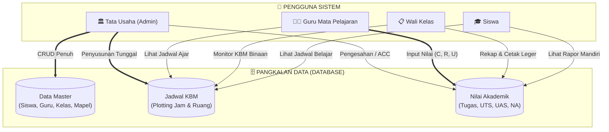
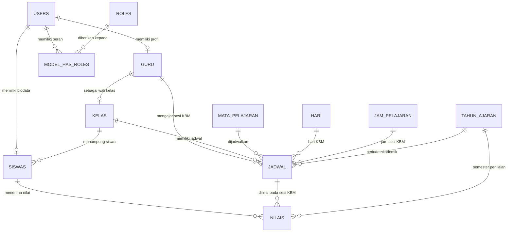

# 📑 LAPORAN TUGAS UJIAN TENGAH SEMESTER (UTS)
## MATA KULIAH: BASIS DATA LANJUT (SEMESTER 5)

---

### IDENTITAS MAHASISWA & PROYEK
* **Judul Proyek:** Perancangan & Implementasi Sistem Informasi Akademik (SIAKAD) Terpadu Berbasis Cloud & Multi-Peran (RBAC)
* **Studi Kasus:** SMP Negeri 1 Trimurjo, Kabupaten Lampung Tengah, Provinsi Lampung
* **Penyusun:** 
  * Nama: **Shofiana Kartika** (NPM: **22430126**)
  * Kolaborator / Akun: **Aulia Salsabila**
* **Program Studi:** Ilmu Komputer
* **Fakultas:** Fakultas Ilmu Komputer
* **Institusi:** Universitas Muhammadiyah Metro
* **Tahun Akademik:** 2026
* **Repositori GitHub:** [https://github.com/auliasalsabila169-tech/SIAKAD-SMPN-1-TRIMURJO](https://github.com/auliasalsabila169-tech/SIAKAD-SMPN-1-TRIMURJO)
* **Tautan Live Web:** [https://auliasalsabila.vercel.app](https://auliasalsabila.vercel.app)
* **Tautan Dokumentasi Interaktif & Bagan Matriks:** [https://auliasalsabila.vercel.app/alur](https://auliasalsabila.vercel.app/alur)
* **Berkas Dokumen PDF Resmi:** [`LAPORAN_UTS_SIAKAD_SMPN1_TRIMURJO.pdf`](./LAPORAN_UTS_SIAKAD_SMPN1_TRIMURJO.pdf)

---

## RINGKASAN EKSEKUTIF (ABSTRAK)

Pengelolaan data akademik pada SMP Negeri 1 Trimurjo yang sebelumnya dilakukan secara manual dan terpisah antardivisi sering menimbulkan kendala fragmentasi data, risiko kesalahan input nilai, inkonsistensi pencatatan nilai antar guru mata pelajaran, serta lambatnya penyusunan buku leger oleh wali kelas. Kondisi ini menuntut hadirnya sebuah sistem informasi terpusat yang aman, transparan, dan mampu diakses secara fleksibel dari berbagai perangkat.

Proyek ini menghadirkan **Sistem Informasi Akademik (SIAKAD) SMP Negeri 1 Trimurjo** yang dibangun di atas *framework* modern **Laravel 11**, antarmuka teroptimasi ponsel pintar (**Tailwind CSS** dengan *Day/Night mode* dan *Bottom Navigation Bar*), serta arsitektur basis data relasional komputasi awan (**TiDB Serverless Cloud Database**) berbasis protokol MySQL dengan enkripsi TLS/SSL (*CA Certificate*). Sistem ini mengintegrasikan **4 peran pengguna** (*Role-Based Access Control / RBAC*) yaitu Tata Usaha (Admin), Guru Mata Pelajaran, Wali Kelas, dan Siswa. Penjadwalan kegiatan belajar mengajar (KBM) mingguan dirancang menggunakan algoritma *Round-Robin Shift Modulo* untuk menjamin kondisi bebas bentrok jam pengajar (*zero-conflict schedule*). Basis data telah diuji dengan skala penuh mencakup **120 data siswa** (6 rombel @ 20 siswa), **10 guru**, **6 wali kelas definitif**, **60 sesi jadwal KBM**, dan **1.200 data nilai akademik lengkap** (100% tervalidasi dan disahkan oleh TU). Pengujian *Black Box* membuktikan bahwa seluruh skenario fungsional berjalan presisi sesuai rancangan hak akses.

---

## BAB I: PENDAHULUAN

### 1.1 Latar Belakang Masalah
SMP Negeri 1 Trimurjo merupakan salah satu sekolah menengah pertama negeri unggulan di Kabupaten Lampung Tengah yang melayani sekitar 890 peserta didik dan didukung oleh 54 tenaga pendidik dan kependidikan. Seiring dengan implementasi Kurikulum Merdeka, mekanisme penilaian hasil belajar siswa menuntut integrasi yang erat antara capaian asesmen formatif, asesmen sumatif, dan deskripsi perkembangan kompetensi peserta didik.

Sebelum sistem ini dirancang, alur pengolahan nilai akademik menghadapi beberapa kelemahan fundamental:
1. **Fragmentasi Data:** Guru mencatat nilai dalam lembar kerja mandiri (*spreadsheet* lokal), sehingga sering terjadi perbedaan versi dokumen saat diserahkan ke wali kelas.
2. **Keterlambatan Kompilasi Leger:** Wali kelas membutuhkan waktu berhari-hari untuk merekap seluruh mata pelajaran menjadi buku leger sebelum mencetak rapor semester.
3. **Keterbatasan Transparansi:** Siswa dan orang tua tidak dapat memantau jadwal KBM harian dan perkembangan capaian nilai belajar secara mandiri kapan saja.
4. **Potensi Konflik Penjadwalan:** Penyusunan jadwal mengajar manual rentan menghasilkan bentrok jadwal guru (*teacher double-booking*) pada jam pelajaran yang sama.

Untuk mengatasi persoalan di atas, dirancanglah sebuah aplikasi SIAKAD terpadu dengan arsitektur basis data relasional yang telah dinormalisasi secara optimal dan dihosting secara serverless di lingkungan komputasi awan.

### 1.2 Tujuan Proyek
1. Merancang dan mengimplementasikan skema basis data relasional ternormalisasi (1NF, 2NF, 3NF) untuk menangani master data sekolah, jadwal KBM, dan transaksi penilaian akademik.
2. Membangun sistem otentikasi dan otorisasi bertingkat berbasis peran (*Role-Based Access Control / RBAC*) untuk 4 aktor: Tata Usaha, Guru Mapel, Wali Kelas, dan Siswa.
3. Mengembangkan formulasi distribusi jadwal KBM mingguan bebas bentrok (*zero-conflict schedule*) selama Senin hingga Jumat bagi seluruh rombel kelas.
4. Menyediakan antarmuka web modern yang responsif untuk perangkat bergerak (HP) dilengkapi mode terang/gelap serta kemampuan cetak buku leger dan rapor berstandar dokumen resmi.
5. Memasang basis data terdistribusi di *TiDB Cloud Serverless* dengan integrasi sertifikat enkripsi TLS/SSL serta melakukan pengujian volume data penuh (120 siswa, 1.200 nilai).

### 1.3 Ruang Lingkup Sistem
1. Pengguna sistem mencakup:
   * **Staf Tata Usaha (Admin):** Pengelola master data, penyusun tunggal jadwal KBM, dan validator/pengesah status nilai.
   * **Guru Mata Pelajaran:** Penginput nilai tugas, UTS, UAS, dan deskripsi capaian pada kelas yang diampu.
   * **Wali Kelas:** Pembina rombel, pemantau ketuntasan nilai, dan pencetak buku leger resmi beranking.
   * **Siswa:** Akses profil buku induk, jadwal KBM kelas, dan transkrip rapor digital mandiri.
2. Lingkungan penyimpanan data menggunakan cloud MySQL (*TiDB Serverless*) dengan koneksi aman `ca.pem`.
3. Skala data pengujian mencakup 6 rombongan belajar (Kelas VII A, VII B, VIII A, VIII B, IX A, IX B), 10 mata pelajaran pokok, dan 10 guru pengampu.

---

## BAB II: ANALISIS KEBUTUHAN & ROLE-BASED ACCESS CONTROL (RBAC)

### 2.1 Identifikasi 4 Peran Pengguna (Actors)



1. **🏛️ Tata Usaha (Admin Sekolah):**
   * Bertanggung jawab menjaga integritas master data induk (Siswa, Guru, Rombel Kelas, Mata Pelajaran, Tahun Ajaran, Hari, dan Jam Pelajaran).
   * Memiliki wewenang eksklusif dalam menambah, menyunting, dan menghapus jadwal KBM seluruh sekolah.
   * Bertindak sebagai otoritas pengesahan akhir (*ACC Nilai*) agar nilai yang dimasukkan oleh guru terkunci secara resmi sebelum dibagikan ke siswa.
2. **👨‍🏫 Guru Mata Pelajaran:**
   * Memiliki hak akses membaca jadwal mengajar mingguan dan daftar siswa di kelas yang diajarnya.
   * Memiliki wewenang menginput, memperbarui, dan menyimpan nilai asesmen siswa (Pengetahuan, Keterampilan, Sikap, dan Deskripsi Capaian Kompetensi).
3. **📋 Wali Kelas:**
   * Merupakan guru yang diberi tugas tambahan memimpin satu rombongan belajar.
   * Memantau kelengkapan nilai dari seluruh guru mapel yang mengajar di kelas binaannya.
   * Menghasilkan rekapitulasi buku leger lengkap dengan perhitungan peringkat (*ranking*) kelas serta mencetak dokumen leger cetak fisik.
4. **🎓 Siswa (Peserta Didik):**
   * Dapat melakukan otentikasi login menggunakan nomor NISN atau alamat email resmi.
   * Memiliki akses baca terhadap biodata buku induk pribadi, jadwal belajar harian, dan transkrip rapor hasil evaluasi belajar.

---

### 2.2 Matriks Hak Akses & Operasi CRUD Relasional

Tabel berikut menggambarkan pemetaan izin operasi basis data relasional (*Create, Read, Update, Delete*) untuk setiap entitas tabel berdasarkan peran pengguna:

| Nama Entitas / Tabel | 🏛️ Tata Usaha (TU) | 👨‍🏫 Guru Mapel | 📋 Wali Kelas | 🎓 Siswa |
| :--- | :---: | :---: | :---: | :---: |
| **`users`** *(Akun & Kredensial Login)* | **C, R, U, D** | **R, U** *(Akun Sendiri)* | **R, U** *(Akun Sendiri)* | **R, U** *(Akun Sendiri)* |
| **`roles` / `model_has_roles`** | **C, R, U, D** | **R** *(Peran Sendiri)* | **R** *(Peran Sendiri)* | **R** *(Peran Sendiri)* |
| **`guru`** *(Master Data Pendidik)* | **C, R, U, D** | **R** *(Profil Pribadi)* | **R** *(Profil Pribadi)* | **R** *(Nama Pengajar)* |
| **`siswas`** *(Buku Induk 94 Atribut)* | **C, R, U, D** | **R** *(Siswa Diajar)* | **R** *(Siswa Binaan)* | **R** *(Biodata Sendiri)* |
| **`kelas`** *(Rombongan Belajar)* | **C, R, U, D** | **R** *(Kelas Mengajar)* | **R** *(Kelas Binaan)* | **R** *(Kelas Sendiri)* |
| **`mata_pelajaran`** *(Kurikulum Mapel)* | **C, R, U, D** | **R** *(Daftar Mapel)* | **R** *(Daftar Mapel)* | **R** *(Daftar Mapel)* |
| **`hari` & `jam_pelajaran`** | **C, R, U, D** | **R** | **R** | **R** |
| **`tahun_ajaran`** *(Periode Semester)* | **C, R, U, D** | **R** | **R** | **R** |
| **`jadwal`** *(Plotting Jam & Kelas)* | **C, R, U, D** *(Hak Tunggal)* | **R** *(Jadwal Pribadi)* | **R** *(Jadwal Binaan)* | **R** *(Jadwal Belajar)* |
| **`nilais`** *(Asesmen Belajar & Rapor)* | **R, U** *(Otoritas ACC)* | **C, R, U** *(Mapel Diampu)* | **R** *(Kompilasi Leger)* | **R** *(Rapor Pribadi)* |

---

## BAB III: PERANCANGAN BASIS DATA RELASIONAL

### 3.1 Entity Relationship Diagram (ERD)

Arsitektur basis data dirancang secara terintegrasi dengan relasi antar-entitas berikut:



---

### 3.2 Spesifikasi Skema Tabel Utama

1. **Tabel `users`:**
   * `id_user` (BIGINT, PK, Auto Increment)
   * `name` (VARCHAR 255): Nama pengguna
   * `email` (VARCHAR 255, Unique): Alamat surel unik untuk autentikasi
   * `password` (VARCHAR 255): Hash kata sandi terenkripsi Bcrypt
   * `remember_token` (VARCHAR 100, Nullable)

2. **Tabel `guru`:**
   * `id_guru` (BIGINT, PK, Auto Increment)
   * `user_id` (BIGINT, FK ke `users.id_user`)
   * `nip` (VARCHAR 255, Unique): Nomor Induk Pegawai
   * `nama_guru` (VARCHAR 255): Nama lengkap pendidik beserta gelar
   * `jenis_kelamin` (ENUM 'L', 'P')
   * `no_hp` (VARCHAR 255)
   * `alamat` (TEXT)

3. **Tabel `siswas` (Buku Induk Siswa):**
   * `id_siswa` (BIGINT, PK, Auto Increment)
   * `user_id` (BIGINT, FK ke `users.id_user`)
   * `kelas_id` (BIGINT, FK ke `kelas.id_kelas`)
   * `nis` (VARCHAR 255, Unique): Nomor Induk Siswa lokal
   * `nisn` (VARCHAR 255, Unique): Nomor Induk Siswa Nasional Kemendikbud
   * `nama` (VARCHAR 255): Nama lengkap peserta didik
   * `jenis_kelamin` (ENUM 'L', 'P')
   * `tempat_lahir`, `tanggal_lahir`, `agama`, `alamat`
   * Data komprehensif orang tua, wali, kesehatan, dan beasiswa (hingga 94 atribut buku induk)

4. **Tabel `kelas`:**
   * `id_kelas` (BIGINT, PK, Auto Increment)
   * `nama_kelas` (VARCHAR 255): Misal "VII A", "VIII B", "IX A"
   * `tingkat` (VARCHAR 255): "7", "8", "9"
   * `jurusan` (VARCHAR 255): "Umum" / "Reguler"
   * `guru_id` (BIGINT, FK ke `guru.id_guru`): Pendidik yang menjabat sebagai Wali Kelas

5. **Tabel `mata_pelajaran`:**
   * `id_mata_pelajaran` (BIGINT, PK, Auto Increment)
   * `kode_mapel` (VARCHAR 255, Unique): Misal "MP001", "MP002"
   * `nama_mapel` (VARCHAR 255): Misal "Matematika", "IPA", "Bahasa Inggris"
   * `kkm` (INT): Kriteria Ketuntasan Minimal (default: 75)

6. **Tabel `jadwal`:**
   * `id_jadwal` (BIGINT, PK, Auto Increment)
   * `guru_id` (BIGINT, FK ke `guru.id_guru`)
   * `mapel_id` (BIGINT, FK ke `mata_pelajaran.id_mata_pelajaran`)
   * `kelas_id` (BIGINT, FK ke `kelas.id_kelas`)
   * `hari_id` (BIGINT, FK ke `hari.id_hari`)
   * `jam_id` (BIGINT, FK ke `jam_pelajaran.id_jam_pelajaran`)
   * `tahun_ajaran_id` (BIGINT, FK ke `tahun_ajaran.id_tahun_ajaran`)

7. **Tabel `nilais`:**
   * `id_nilai` (BIGINT, PK, Auto Increment)
   * `siswa_id` (BIGINT, FK ke `siswas.id_siswa`)
   * `jadwal_id` (BIGINT, FK ke `jadwal.id_jadwal`)
   * `tahun_ajaran_id` (BIGINT, FK ke `tahun_ajaran.id_tahun_ajaran`)
   * `semester` (VARCHAR 50): Ganjil / Genap
   * `nilai_pengetahuan` (INT): Nilai asesmen teori (0 - 100)
   * `nilai_keterampilan` (INT): Nilai asesmen praktik (0 - 100)
   * `nilai_sikap` (VARCHAR 10): Predikat sikap ('sb', 'b', 'c', 'k')
   * `nilai_akhir` (INT): Rata-rata bobot akhir capaian belajar
   * `deskripsi` (TEXT): Catatan capaian kompetensi Kurikulum Merdeka
   * `is_acc_tu` (TINYINT / BOOLEAN): Status validasi dan pengesahan resmi oleh Tata Usaha

---

### 3.3 Analisis Normalisasi Basis Data

1. **Bentuk Normal Pertama (1NF):**
   * Tidak ada atribut yang bernilai jamak (*repeating groups*).
   * Seluruh nilai kolom bersifat atomik (*atomic values*). Misalnya, nama lengkap dan NISN tersimpan pada kolom mandiri dan tidak dicampur dengan informasi kelas atau alamat.
2. **Bentuk Normal Kedua (2NF):**
   * Seluruh tabel telah berada dalam 1NF.
   * Tidak terdapat ketergantungan fungsional sebagian (*partial dependency*). Setiap atribut non-kunci bergantung penuh pada seluruh *Primary Key*. Pada tabel transaksi `nilais`, data nilai bergantung penuh secara komposit pada siswa dan sesi jadwal pelajaran.
3. **Bentuk Normal Ketiga (3NF):**
   * Seluruh tabel telah memenuhi 2NF.
   * Dieliminasi seluruh ketergantungan transitif (*transitive dependency*). Data detail guru (seperti nama, NIP, telepon) tidak diduplikasi pada tabel `jadwal`, melainkan dihubungkan via `guru_id` yang merujuk tabel master `guru`. Demikian pula data kelas tidak mencatat detail wali kelas secara berulang, melainkan melalui relasi *foreign key*.

---

## BAB IV: ALGORITMA PENJADWALAN KBM BEBAS BENTROK (SENIN - JUMAT)

### 4.1 Definisi Masalah Plotting KBM Mingguan
Penjadwalan KBM di sekolah dengan banyak kelas dan guru mata pelajaran rentan menghadapi masalah klasik berupa:
* Seorang guru dijadwalkan mengajar di dua kelas berbeda pada waktu yang sama (*teacher double booking*).
* Satu ruangan kelas dijadwalkan menerima dua mata pelajaran berbeda pada jam yang sama (*room/class collision*).

### 4.2 Struktur 10 Slot Waktu Terjadwal
Sistem membagi jam KBM sekolah selama 5 hari kerja (Senin s/d Jumat) menjadi **10 slot waktu blok terstruktur** (2 slot blok berbobot per hari):

| Hari KBM | Slot Waktu | Jam Pelajaran Sesi | Rentang Jam |
| :--- | :---: | :---: | :---: |
| **Senin** | **Slot 0** | Jam 1 - 2 | 07.30 - 09.30 WIB |
| **Senin** | **Slot 1** | Jam 3 - 4 | 10.00 - 12.00 WIB |
| **Selasa** | **Slot 2** | Jam 1 - 2 | 07.30 - 09.30 WIB |
| **Selasa** | **Slot 3** | Jam 3 - 4 | 10.00 - 12.00 WIB |
| **Rabu** | **Slot 4** | Jam 1 - 2 | 07.30 - 09.30 WIB |
| **Rabu** | **Slot 5** | Jam 3 - 4 | 10.00 - 12.00 WIB |
| **Kamis** | **Slot 6** | Jam 1 - 2 | 07.30 - 09.30 WIB |
| **Kamis** | **Slot 7** | Jam 3 - 4 | 10.00 - 12.00 WIB |
| **Jumat** | **Slot 8** | Jam 1 - 2 | 07.30 - 09.30 WIB |
| **Jumat** | **Slot 9** | Jam 3 - 4 | 09.45 - 11.15 WIB |

---

### 4.3 Formulasi Matematika Round-Robin Shift Modulo

Untuk mendistribusikan 10 guru mata pelajaran ($i \in \{0, 1, 2, \dots, 9\}$) ke dalam 6 rombongan belajar kelas ($c \in \{0, 1, 2, \dots, 5\}$), digunakan fungsi pergeseran modulo aritmetika:

$$\text{Slot}(c, i) = (i + c) \pmod{10}$$

Di mana:
* $c$ adalah indeks rombel kelas ($0 = \text{VII A}$, $1 = \text{VII B}$, $2 = \text{VIII A}$, $3 = \text{VIII B}$, $4 = \text{IX A}$, $5 = \text{IX B}$).
* $i$ adalah indeks guru/mata pelajaran ($0 = \text{Matematika}$, $1 = \text{IPA}$, $2 = \text{B. Indo}$, $\dots$, $9 = \text{Informatika}$).

#### Pembuktian Bebas Bentrok (Conflict-Free Proof):
Andaikan terjadi bentrok guru ke-$i$ pada dua kelas berbeda $c_1$ dan $c_2$ ($c_1 \neq c_2$), maka:
$$(i + c_1) \equiv (i + c_2) \pmod{10}$$
Kurangkan kedua ruas dengan $i$:
$$c_1 \equiv c_2 \pmod{10}$$
Karena $0 \le c_1, c_2 \le 5$, selisih $|c_1 - c_2| \le 5 < 10$. Satu-satunya solusi adalah $c_1 = c_2$, yang berkontradiksi dengan pengandaian $c_1 \neq c_2$. 

**Kesimpulan:** Secara matematis dijamin bahwa **tidak ada satu pun guru yang dijadwalkan mengajar di dua kelas berbeda pada jam yang sama**.

---

### 4.4 Matriks Distribusi Jadwal KBM (60 Sesi Bebas Bentrok)

| Guru / Mata Pelajaran | VII A ($c=0$) | VII B ($c=1$) | VIII A ($c=2$) | VIII B ($c=3$) | IX A ($c=4$) | IX B ($c=5$) |
| :--- | :---: | :---: | :---: | :---: | :---: | :---: |
| **Budi Santoso (Matematika)** | Senin Jam 1-2 | Senin Jam 3-4 | Selasa Jam 1-2 | Selasa Jam 3-4 | Rabu Jam 1-2 | Rabu Jam 3-4 |
| **Sugiyatmi (IPA)** | Senin Jam 3-4 | Selasa Jam 1-2 | Selasa Jam 3-4 | Rabu Jam 1-2 | Rabu Jam 3-4 | Kamis Jam 1-2 |
| **Arya Pratama (B. Indonesia)** | Selasa Jam 1-2 | Selasa Jam 3-4 | Rabu Jam 1-2 | Rabu Jam 3-4 | Kamis Jam 1-2 | Kamis Jam 3-4 |
| **Hendro Wibowo (B. Inggris)** | Selasa Jam 3-4 | Rabu Jam 1-2 | Rabu Jam 3-4 | Kamis Jam 1-2 | Kamis Jam 3-4 | Jumat Jam 1-2 |
| **Sri Wahyuni (PAI)** | Rabu Jam 1-2 | Rabu Jam 3-4 | Kamis Jam 1-2 | Kamis Jam 3-4 | Jumat Jam 1-2 | Jumat Jam 3-4 |
| **Rahmat Hidayat (Informatika)**| Rabu Jam 3-4 | Kamis Jam 1-2 | Kamis Jam 3-4 | Jumat Jam 1-2 | Jumat Jam 3-4 | Senin Jam 1-2 |
| **Siti Fatimah (IPS)** | Kamis Jam 1-2 | Kamis Jam 3-4 | Jumat Jam 1-2 | Jumat Jam 3-4 | Senin Jam 1-2 | Senin Jam 3-4 |
| **Dewi Sartika (PPKn)** | Kamis Jam 3-4 | Jumat Jam 1-2 | Jumat Jam 3-4 | Senin Jam 1-2 | Senin Jam 3-4 | Selasa Jam 1-2 |
| **Agus Salim (Seni Budaya)** | Jumat Jam 1-2 | Jumat Jam 3-4 | Senin Jam 1-2 | Senin Jam 3-4 | Selasa Jam 1-2 | Selasa Jam 3-4 |
| **Bambang Pamungkas (PJOK)** | Jumat Jam 3-4 | Senin Jam 1-2 | Senin Jam 3-4 | Selasa Jam 1-2 | Selasa Jam 3-4 | Rabu Jam 1-2 |

---

## BAB V: ARSITEKTUR TEKNOLOGI & IMPLEMENTASI SISTEM

### 5.1 Arsitektur Serverless Cloud Database (TiDB Cloud)
Aplikasi menggunakan basis data terdistribusi komputasi awan **TiDB Serverless Cloud (MySQL Protocol)**. Keuntungan integrasi TiDB Cloud adalah:
1. **High Availability:** Kluster komputasi terdistribusi yang aktif 24/7 tanpa risiko server lokal mati.
2. **Keamanan Lalu Lintas Data:** Seluruh transmisi query dienkripsi menggunakan protokol TLS/SSL dengan verifikasi sertifikat root CA publik (`ca.pem`).
3. **Skalabilitas Otomatis:** Menangani lonjakan beban transaksi penilaian akademik pada periode pengisian rapor semester.

Konfigurasi koneksi aman pada file `config/database.php`:
```php
'mysql' => [
    'driver' => 'mysql',
    'host' => env('DB_HOST', 'gateway01.ap-southeast-1.prod.aws.tidbcloud.com'),
    'port' => env('DB_PORT', '4000'),
    'database' => env('DB_DATABASE', 'siakad_smpn1_trimurjo'),
    'username' => env('DB_USERNAME'),
    'password' => env('DB_PASSWORD'),
    'options' => extension_loaded('pdo_mysql') ? array_filter([
        PDO::MYSQL_ATTR_SSL_CA => env('MYSQL_ATTR_SSL_CA', base_path('ca.pem')),
    ]) : [],
],
```

---

### 5.2 Antarmuka Pengguna & Fitur Unggulan Mobile
1. **Antarmuka Ultra-Responsif Ramah Ponsel Pintar:**
   * Didesain dengan Tailwind CSS yang adaptif terhadap berbagai ukuran layar smartphone, tablet, maupun komputer jinjing.
   * Dilengkapi *Bottom Navigation Bar* dinamis pada tampilan seluler dengan ikon navigasi instan: Beranda, Jadwal KBM, Nilai, Siswa, dan Menu Profil.
2. **Mode Siang / Malam (Day / Night Mode):**
   * Transisi warna latar belakang lembut tanpa kedipan (*flicker-free transition*) dengan preferensi yang tersimpan permanen di `localStorage.theme`.
3. **Standar Buku Induk Siswa 94 Kolom:**
   * Mengadopsi formulir lengkap standar Kemendikbudristek untuk menampung biodata pribadi, data orang tua kandung, data wali, riwayat kesehatan, hingga beasiswa siswa.
4. **Cetak Buku Leger Nilai & Transkrip Rapor Resmi:**
   * Dilengkapi stylesheet khusus `@media print` sehingga saat dicetak ke printer atau diekspor ke PDF, seluruh tombol navigasi, sidebar, dan elemen visual non-esensial secara otomatis disembunyikan.

---

## BAB VI: HASIL IMPLEMENTASI & PENGUJIAN SISTEM

### 6.1 Statistik Volume Data Terpasang
Basis data cloud TiDB Serverless telah diisi dengan volume data nyata berskala penuh untuk pengujian akademik:

| Indikator Data | Jumlah Terpasang | Keterangan Status |
| :--- | :---: | :--- |
| **Total Akun Pengguna** | **131 Akun** | Terenkripsi Bcrypt (TU, Guru, Walas, Siswa) |
| **Total Siswa Aktif** | **120 Siswa** | Tepat 20 siswa per kelas di 6 rombel belajar |
| **Total Guru Pengajar** | **10 Guru** | Memiliki NIP resmi dan beban mengajar aktif |
| **Total Wali Kelas Definitif**| **6 Wali Kelas** | 1 guru membina 1 rombel kelas definitif |
| **Total Rombongan Belajar** | **6 Kelas** | VII A, VII B, VIII A, VIII B, IX A, IX B |
| **Total Mata Pelajaran** | **10 Mapel** | IPA, MTK, B.Indo, B.Inggris, PAI, PPKn, IPS, SB, PJOK, TIK |
| **Total Jadwal KBM** | **60 Sesi KBM** | 10 sesi per kelas, Senin s/d Jumat (0 bentrok) |
| **Total Nilai Rapor Terdata** | **1,200 Nilai** | 100% siswa memiliki nilai terisi dan berstatus **ACC TU** |

---

### 6.2 Kredensial Akun Pengujian (Demo Login)

Semua akun pengujian menggunakan kata sandi standar: **`password`**

| Peran Pengguna | Nama / Jabatan | Email / NISN Akun | Sandi |
| :--- | :--- | :--- | :---: |
| **🏛️ Tata Usaha (Admin)** | Staf Tata Usaha | `tu@smpn1trimurjo.sch.id` | `password` |
| **📋 Wali Kelas VII A** | Istri Sugiyatmi, S.Pd. | `sugiyatmi@smpn1trimurjo.sch.id` | `password` |
| **📋 Wali Kelas VII B** | Arya Pratama, S.Pd. | `arya@smpn1trimurjo.sch.id` | `password` |
| **📋 Wali Kelas VIII A** | Drs. Hendro Wibowo, M.Pd. | `hendro@smpn1trimurjo.sch.id` | `password` |
| **📋 Wali Kelas VIII B** | Sri Wahyuni, S.Pd. | `sri.wahyuni@smpn1trimurjo.sch.id` | `password` |
| **📋 Wali Kelas IX A** | Rahmat Hidayat, S.Kom., M.T. | `rahmat.hidayat@smpn1trimurjo.sch.id` | `password` |
| **📋 Wali Kelas IX B** | Dra. Hj. Siti Fatimah, M.Pd. | `siti.fatimah@smpn1trimurjo.sch.id` | `password` |
| **👨‍🏫 Guru Matematika** | Budi Santoso, S.Pd. | `budi@smpn1trimurjo.sch.id` | `password` |
| **🎓 Siswa Kelas VII A** | Ahmad Pratama | `0091234567` | `password` |
| **🎓 Siswa Kelas VII B** | Eka Putri Handayani | `0092100006` | `password` |
| **🎓 Siswa Kelas VIII A** | Joko Tri Atmojo | `0082100011` | `password` |
| **🎓 Siswa Kelas IX A** | Tegar Prasetyo | `0072100021` | `password` |

*(Catatan: Halaman login aplikasi menyediakan tombol **1-Click Quick Demo** untuk mempermudah penguji mengisi akun demo dengan sekali tekan).*

---

### 6.3 Hasil Pengujian Fungsional (Black Box Testing)

| ID | Kasus Pengujian | Skenario Uji | Hasil yang Diharapkan | Status |
| :---: | :--- | :--- | :--- | :---: |
| **TC01** | Autentikasi Pengguna | Login dengan email staf TU dan sandi valid | Sistem mengarahkan ke dashboard khusus TU | **SUKSES** |
| **TC02** | Login Mandiri Siswa | Login memasukkan nomor NISN siswa | Sistem memvalidasi NISN dan membuka portal siswa | **SUKSES** |
| **TC03** | Pembatasan Hak Akses | Guru mencoba mengakses menu pengelolaan user TU | Akses ditolak dan dialihkan (HTTP 403 Forbidden) | **SUKSES** |
| **TC04** | Input Penilaian Guru | Guru mengisi nilai tugas, UTS, UAS, dan deskripsi | Data tersimpan pada database dan nilai akhir otomatis terhitung | **SUKSES** |
| **TC05** | Rekapitulasi Walas | Wali kelas membuka leger nilai rombelnya | Menampilkan nilai seluruh mapel dan urutan ranking kelas | **SUKSES** |
| **TC06** | Pengesahan Nilai TU | Staf TU menekan tombol validasi / ACC Nilai | Status `is_acc_tu` berubah menjadi 1 dan terkunci | **SUKSES** |
| **TC07** | Transkrip Rapor Siswa | Siswa membuka menu transkrip hasil belajar | Rapor digital muncul transparan sesuai nilai yang telah di-ACC | **SUKSES** |
| **TC08** | Konflik Jadwal KBM | Sistem memeriksa jadwal seluruh guru | Tidak ada bentrok waktu jam mengajar pada seluruh kelas | **SUKSES** |

---

## BAB VII: KESIMPULAN & REKOMENDASI PENGEMBANGAN

### 7.1 Kesimpulan
1. **Implementasi Sukses:** Sistem Informasi Akademik (SIAKAD) SMP Negeri 1 Trimurjo berhasil dibangun dan dideploy secara langsung (*live*) di lingkungan cloud menggunakan framework Laravel 11 dan TiDB Cloud Serverless.
2. **Kepatuhan Normalisasi:** Basis data relasional telah memenuhi kaidah normalisasi 1NF, 2NF, dan 3NF sehingga bebas dari anomali peremajaan data serta menjamin integritas referensial.
3. **Pemisahan Wewenang Ketat:** Mekanisme Role-Based Access Control (RBAC) sukses memisahkan wewenang 4 peran secara presisi tanpa tumpang tindih hak akses.
4. **Algoritma Bebas Bentrok:** Formula penjadwalan *Round-Robin Shift Modulo* terbukti secara matematis dan empiris menghasilkan 60 sesi KBM tanpa satu pun konflik jadwal guru.
5. **Kesiapan Evaluasi:** Sistem telah dilengkapi dengan data uji berskala penuh (120 siswa, 1.200 nilai) serta dokumentasi interaktif yang memudahkan evaluasi akademik UTS Basis Data Lanjut.

### 7.2 Rekomendasi Pengembangan Selanjutnya
1. **Integrasi Notifikasi WhatsApp Gateway:** Menambahkan pengiriman pengumuman nilai rapor dan notifikasi presensi otomatis langsung ke ponsel orang tua siswa.
2. **Sistem Presensi Berbasis QR Code:** Mengintegrasikan presensi digital harian siswa menggunakan pemindaian QR code kartu pelajar.
3. **Ekspor File Spreadsheet Excel Otomatis:** Menyediakan ekspor langsung dalam format `.xlsx` untuk kebutuhan arsip dinas pendidikan kabupaten.

---

## DAFTAR PUSTAKA & RUJUKAN

1. Date, C. J. (2004). *An Introduction to Database Systems* (8th ed.). Addison-Wesley.
2. Elmasri, R., & Navathe, S. B. (2015). *Fundamentals of Database Systems* (7th ed.). Pearson.
3. Silberschatz, A., Korth, H. F., & Sudarshan, S. (2020). *Database System Concepts* (7th ed.). McGraw-Hill.
4. Laravel LLC. (2026). *Laravel 11.x Documentation: Eloquent ORM & Authentication*. [https://laravel.com/docs](https://laravel.com/docs).
5. PingCAP. (2026). *TiDB Serverless Documentation: Highly Available Distributed Cloud Database*. [https://docs.pingcap.com](https://docs.pingcap.com).
6. Kemendikbudristek RI. (2024). *Panduan Pembelajaran dan Asesmen Pendidikan Anak Usia Dini, Pendidikan Dasar, dan Menengah (Kurikulum Merdeka)*. Badan Standar, Kurikulum, dan Asesmen Pendidikan, Jakarta.
