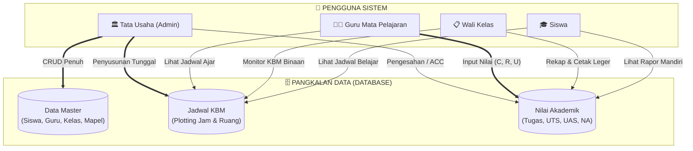

# 🏫 SIAKAD SMP NEGERI 1 TRIMURJO
### Sistem Informasi Akademik Terpadu Berbasis Cloud & Role-Based Access Control (RBAC)
> **Tugas Ujian Tengah Semester (UTS) — Basis Data Lanjut | Semester 5**  
> **Penyusun:** Aulia Salsabila (NPM: 24430076) | Program Studi S1 Ilmu Komputer, Fakultas Ilmu Komputer (FIKOM), Universitas Muhammadiyah Metro  
> **Repositori Resmi:** [https://github.com/auliasalsabila169-tech/SIAKAD-SMPN-1-TRIMURJO](https://github.com/auliasalsabila169-tech/SIAKAD-SMPN-1-TRIMURJO)  
> **Website Live (Hosting Vercel):** [https://auliasalsabila.vercel.app](https://auliasalsabila.vercel.app)  
> **Dokumentasi Interaktif & Bagan Matriks:** [https://auliasalsabila.vercel.app/alur](https://auliasalsabila.vercel.app/alur)  
> **📄 Laporan Resmi (PDF):** [**Unduh / Lihat LAPORAN_UTS_SIAKAD_SMPN1_TRIMURJO.pdf**](./LAPORAN_UTS_SIAKAD_SMPN1_TRIMURJO.pdf)  
> **📑 Laporan Lengkap (Markdown):** [**Baca LAPORAN_UTS.md**](./LAPORAN_UTS.md)  

---

[](./LAPORAN_UTS_SIAKAD_SMPN1_TRIMURJO.pdf)

[](https://laravel.com)
[](https://php.net)
[-00758F?style=for-the-badge&logo=mysql&logoColor=white)](https://tidbcloud.com)
[](https://tailwindcss.com)
[](https://auliasalsabila.vercel.app)

---

## 📌 Ringkasan Proyek

**SIAKAD SMP Negeri 1 Trimurjo** adalah aplikasi sistem informasi akademik komprehensif yang dirancang untuk mendigitalkan seluruh siklus akademik di tingkat sekolah menengah pertama. Sistem ini mengintegrasikan **4 entitas pengguna utama (Tata Usaha, Guru Mata Pelajaran, Wali Kelas, dan Siswa)** dengan basis data terdistribusi di cloud (**TiDB Cloud Serverless MySQL**) yang mendukung koneksi aman via TLS/SSL.

Aplikasi dibangun dengan arsitektur **Role-Based Access Control (RBAC)** ketat, antarmuka **ultra-responsif ramah smartphone (HP)**, fitur **Mode Siang / Malam (Day & Night Mode)**, serta alur KBM bebas bentrok jam pengajar (*conflict-free schedule*).

---

## 👥 4 Peran Pengguna & Hak Akses (RBAC)



1. **🏛️ Tata Usaha (Admin / TU):**
   - Mengelola master data induk (120 Siswa, 10 Guru, 6 Rombel Kelas, 10 Mata Pelajaran).
   - Otoritas eksklusif pembuatan dan penyuntingan jadwal KBM mingguan.
   - Melakukan pengawasan rekapitulasi nilai dan menerbitkan pengesahan (*ACC Nilai*).
2. **👨‍🏫 Guru Mata Pelajaran:**
   - Memeriksa jadwal mengajar mingguan sesuai jam dan rombel.
   - Menginput dan memperbarui nilai asesmen siswa (Formatif/Tugas, UTS, UAS, dan Nilai Akhir).
3. **📋 Wali Kelas (6 Rombel):**
   - Memantau kelengkapan nilai dari seluruh guru mapel untuk siswa kelas binaannya.
   - Merekap buku Leger nilai terpadu dan mencetak Leger resmi lengkap dengan ranking kelas.
4. **🎓 Siswa:**
   - Login mandiri menggunakan nomor NISN atau email dinas siswa.
   - Memeriksa jadwal pelajaran harian/mingguan di layar handphone.
   - Mengakses transkrip nilai capaian pembelajaran dan rapor semester digital.

---

## 🗄️ Skema Basis Data & Matriks Entitas

### Matriks Operasi CRUD (Role-Based Matrix):
| Entitas / Tabel | Tata Usaha (TU) | Guru Mapel | Wali Kelas | Siswa |
| :--- | :---: | :---: | :---: | :---: |
| **`users`** *(Akun Login)* | **C, R, U, D** | **R, U** *(Sendiri)* | **R, U** *(Sendiri)* | **R, U** *(Sendiri)* |
| **`guru`** *(Data Pendidik)* | **C, R, U, D** | **R** *(Profil)* | **R** *(Profil)* | **R** *(Nama Guru)* |
| **`siswas`** *(Buku Induk)* | **C, R, U, D** | **R** *(Siswa Diajar)* | **R** *(Siswa Binaan)* | **R** *(Profil Pribadi)* |
| **`kelas`** *(Rombongan Belajar)* | **C, R, U, D** | **R** | **R** *(Kelas Binaan)* | **R** *(Kelas Sendiri)* |
| **`mata_pelajaran`** *(Kurikulum)* | **C, R, U, D** | **R** | **R** | **R** |
| **`jadwal`** *(Plotting Sesi KBM)* | **C, R, U, D** | **R** *(Jadwal Ajar)* | **R** *(Jadwal Binaan)* | **R** *(Jadwal Belajar)* |
| **`nilais`** *(Asesmen & Capaian)* | **R, U** *(Pengesahan ACC)* | **C, R, U** *(Mapel Diampu)* | **R** *(Leger Nilai)* | **R** *(Rapor Sendiri)* |

---

## 📊 Statistik Data Dummy Terpasang

Basis data online telah diisi dengan data realistis berskala penuh:
- **120 Data Siswa Lengkap** (Tepat 20 siswa pada masing-masing rombel: VII A, VII B, VIII A, VIII B, IX A, IX B).
- **10 Guru Pengajar** (Masing-masing mengampu 2 s/d 6 sesi KBM per minggu).
- **6 Wali Kelas** (1 Walas definitif per rombongan belajar).
- **10 Mata Pelajaran Pokok SMP** (IPA, Matematika, B. Indonesia, B. Inggris, PAI, PPKn, IPS, Seni Budaya, PJOK, Informatika).
- **60 Sesi Jadwal KBM** (Senin s/d Jumat terdistribusi rapi tanpa bentrok waktu guru).
- **1,200 Nilai Siswa Lengkap** (100% siswa memiliki nilai terisi di semua mapel dan berstatus disahkan oleh TU).

---

## 🔑 Kredensial Akun Pengujian (Demo Login)

Seluruh akun menggunakan kata sandi default: `password`

| Peran | Nama / Jabatan | Email / ID / NISN | Kata Sandi |
| :--- | :--- | :--- | :---: |
| **Tata Usaha** | Administrator TU | `tu@smpn1trimurjo.sch.id` | `password` |
| **Wali Kelas VII A** | Istri Sugiyatmi, S.Pd. | `sugiyatmi@smpn1trimurjo.sch.id` | `password` |
| **Wali Kelas VII B** | Arya Pratama, S.Pd. | `arya@smpn1trimurjo.sch.id` | `password` |
| **Wali Kelas VIII A** | Drs. Hendro Wibowo, M.Pd. | `hendro@smpn1trimurjo.sch.id` | `password` |
| **Wali Kelas VIII B** | Sri Wahyuni, S.Pd. | `sri.wahyuni@smpn1trimurjo.sch.id` | `password` |
| **Wali Kelas IX A** | Rahmat Hidayat, S.Kom., M.T. | `rahmat.hidayat@smpn1trimurjo.sch.id` | `password` |
| **Wali Kelas IX B** | Dra. Hj. Siti Fatimah, M.Pd. | `siti.fatimah@smpn1trimurjo.sch.id` | `password` |
| **Guru Matematika** | Budi Santoso, S.Pd. | `budi@smpn1trimurjo.sch.id` | `password` |
| **Siswa VII A** | Ahmad Pratama | `0091234567` | `password` |
| **Siswa VII B** | Eka Putri Handayani | `0092100006` | `password` |
| **Siswa VIII A** | Joko Tri Atmojo | `0082100011` | `password` |
| **Siswa IX A** | Tegar Prasetyo | `0072100021` | `password` |

*(Pada halaman login tersedia fitur **1-Click Quick Demo** yang otomatis mengisi email dan sandi dengan satu sentuhan).*

---

## ✨ Fitur Unggulan Sistem

1. **🎨 Tampilan Modern & Mode Siang / Malam (Day/Night Mode):**
   - Menggunakan Tailwind CSS dengan transisi lembut tanpa kedipan (*flicker-free*), tersimpan permanen di `localStorage.theme`.
2. **📱 Pengalaman Mobile Sempurna (Bottom Navigation Bar):**
   - Saat diakses melalui smartphone/HP, muncul menu bilah bawah (*bottom bar*) mirip aplikasi Android/iOS untuk navigasi instan: Beranda, Jadwal, Nilai, Siswa, dan Menu Lengkap.
3. **⚡ Jam Akademik Realtime WIB:**
   - Widget waktu detik demi detik di layar masuk untuk sinkronisasi KBM sekolah.
4. **🖨️ Cetak Leger Nilai & Transkrip Rapor Digital:**
   - Cetak cetakan resmi yang disesuaikan secara khusus untuk format kertas cetak (`@media print`).
5. **☁️ Cloud Database Resilience:**
   - Dilengkapi TLS CA certificate validation (`ca.pem`) untuk keamanan lalu lintas data cloud.

---

## 🚀 Panduan Instalasi Lokal

### 1. Klon Repositori
```bash
git clone https://github.com/auliasalsabila169-tech/SIAKAD-SMPN-1-TRIMURJO.git
cd SIAKAD-SMPN-1-TRIMURJO
```

### 2. Pasang Dependensi
```bash
composer install
npm install && npm run build
```

### 3. Konfigurasi Lingkungan (.env)
Salin `.env.example` menjadi `.env` dan sesuaikan koneksi basis data:
```env
APP_NAME="SIAKAD SMPN 1 Trimurjo"
APP_ENV=local
APP_KEY=base64:...
APP_DEBUG=true
APP_URL=http://localhost:8000

DB_CONNECTION=mysql
DB_HOST=127.0.0.1
DB_PORT=3306
DB_DATABASE=siakad_smpn1_trimurjo
DB_USERNAME=root
DB_PASSWORD=
```

### 4. Impor Basis Data
Impor file `siakad_smpn1_trimurjo.sql` yang telah menyertakan 120 siswa, 10 guru, dan 1,200 nilai:
```bash
mysql -u root -p siakad_smpn1_trimurjo < siakad_smpn1_trimurjo.sql
```

### 5. Jalankan Server Lokal
```bash
php artisan serve
```
Buka browser pada alamat `http://127.0.0.1:8000`.

---

## 🏛️ Struktur Direktori Utama

```
siakad-smp/
├── app/
│   ├── Http/Controllers/
│   │   ├── AuthController.php      # Autentikasi multi-peran (Email / NISN)
│   │   ├── TuController.php        # Controller modul Tata Usaha
│   │   ├── WalasController.php     # Controller modul Wali Kelas
│   │   ├── GuruController.php      # Controller modul Guru Mapel
│   │   └── SiswaController.php     # Controller modul Siswa Mandiri
│   └── Models/                     # User, Siswa, Guru, Kelas, Jadwal, Nilai
├── config/
│   └── database.php                # Konfigurasi PDO SSL MySQL / TiDB Cloud
├── database/
│   └── seeders/                    # Database seeder scripts
├── public/
│   ├── alur-siakad.html            # Halaman statis dokumentasi alur & matriks
│   └── images/                     # Aset logo sekolah & favicon
├── resources/views/
│   ├── auth/                       # login.blade.php & register.blade.php
│   ├── layouts/app.blade.php       # Layout utama dengan Day/Night & Mobile Nav
│   ├── panduan/alur.blade.php      # Tampilan interaktif alur & bagan matriks
│   ├── tu/                         # Dashboard, Siswa, Guru, Kelas, Jadwal, Nilai
│   ├── walas/                      # Dashboard, Leger Nilai, Cetak Rapor
│   ├── guru/                       # Dashboard, Input Nilai Siswa
│   └── siswa/                      # Dashboard mandiri, Jadwal KBM, Transkrip
├── vercel.json                     # Konfigurasi deployment Vercel Serverless
└── siakad_smpn1_trimurjo.sql       # Dump database lengkap (120 Siswa, 1,200 Nilai)
```

---

## 📄 Lisensi
Hak Cipta © 2026 SMP Negeri 1 Trimurjo & Pengembang.  
Dikembangkan untuk pemenuhan tugas akademik **Ujian Tengah Semester (UTS) Basis Data Lanjut**.
